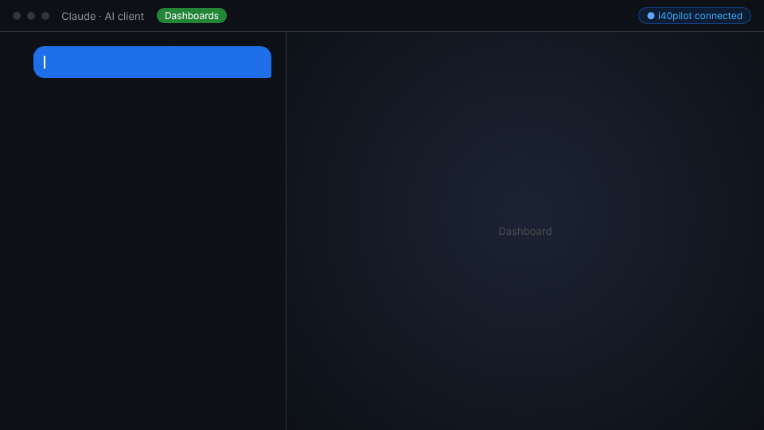

# i40Pilot MCP server

[](https://registry.modelcontextprotocol.io/v0/servers?search=i40pilot) [](https://api.i40pilot.app/mcp) [](docs/static-token.md) [](LICENSE)

**Build manufacturing dashboards, OEE reports, schedules and 3D parts from Claude, ChatGPT, Cursor or any MCP client.**

[i40Pilot](https://i40pilot.app?utm_source=github&utm_medium=mcp_readme) is an industrial BI platform. This repository documents its hosted
[Model Context Protocol](https://modelcontextprotocol.io) server. Point your client at one URL, sign in, and your AI assistant can
read and build in your i40Pilot project.

```
https://api.i40pilot.app/mcp
```

No install, no API key to copy: the server uses **OAuth 2.1** (PKCE, dynamic client registration). You choose the
project and **read-only or read-write** access on the consent screen, and you can revoke it at any time.

> 🇫🇷 *Serveur MCP hébergé d'i40Pilot : collez l'URL ci-dessus dans votre client IA, connectez-vous, choisissez le projet
> et le niveau d'accès. Votre assistant peut alors lire et construire tableaux de bord, TRS/OEE, plannings et pièces 3D.*



## Try it in 60 seconds

1. **Connect** — in Claude.ai: *Settings → Connectors → Add custom connector* → `https://api.i40pilot.app/mcp` → *Connect*. Sign in or create a free account, pick a project.
2. **Ask** — paste one of these into a new conversation. The first two need no data at all:

> **Schedule** — *Plan a gearbox overhaul with i40Pilot: lock-out 1 h, drain 1.5 h, dismantle 3 h, bearings 2.5 h (needs dismantle and the parts delivery, 4 h, which starts at once), sensor check 1 h after lock-out, reassembly 2 h after bearings and sensors, tests 1.5 h. What is the critical path, and how much slack does each task have?*

> **3D** — *With i40Pilot, model a gear motor on a steel base: motor, flange, cast-iron housing welded to its foot, keyed output gear, every bolt a real joint. Then show me a render.*

> **Dashboard** — first bring the sample data in: download [`examples/data/machine-downtime-sample.xlsx`](examples/data/machine-downtime-sample.xlsx) (199 stops, 9 machines, 3 lines, September) and import it in i40Pilot → *Spreadsheets*. Then ask: *Using my i40Pilot workbook "machine-downtime-sample", build a downtime dashboard: total stop minutes, a Pareto of causes, minutes per line and machine, planned vs unplanned.*

> In **Claude Code** or **Cursor**, skip the manual import: the agent can upload the file itself (`drive_create_upload_url`, then `spreadsheet_create_workbook_from_file`). The Claude.ai chat cannot send a file to a URL, hence the import step there.

## One connection, every i40Pilot app

| App | Ask your AI client… |
|---|---|
| 📊 **Dashboards & OEE** | *"Connect my production database and build an OEE cockpit per line: availability, performance, quality, a Pareto of stop causes."* |
| 📈 **Spreadsheets** | *"Read the downtime workbook I uploaded and add a column with the stop duration in minutes."* |
| 🗓️ **Gantt & scheduling** | *"Plan the gearbox overhaul: these 8 tasks, these dependencies — what is the critical path and where is the slack?"* |
| 🧊 **3D design (text-to-CAD)** | *"Model a gear motor on a steel base, every bolt a real joint, and show me a render."* |
| 📅 **Calendar** | *"Book the overhaul on the maintenance calendar and invite the two technicians."* |
| 📝 **Forms** | *"Add a 'root cause' dropdown to the stop-declaration form."* |
| 🔄 **Power BI** | *"Export this dashboard to Power BI."* |

Or hand the whole request to the i40Pilot agent with `i40pilot_chat`, in plain language.

## Connect your client

| Client | How |
|---|---|
| **Claude.ai / Claude Desktop** | Settings → Connectors → *Add custom connector* → paste the URL → *Connect* |
| **ChatGPT** | Settings → Connectors → *Create* → paste the URL → OAuth |
| **Claude Code** | `claude mcp add --transport http i40pilot https://api.i40pilot.app/mcp` then `/mcp` to sign in |
| **Cursor** | add [`examples/cursor-mcp.json`](examples/cursor-mcp.json) to `.cursor/mcp.json` |
| **VS Code** | add [`examples/vscode-mcp.json`](examples/vscode-mcp.json) to `.vscode/mcp.json` |
| **Scripts / services** | a static project token, see [docs/static-token.md](docs/static-token.md) |

You need an i40Pilot account — [create one free](https://i40pilot.app?utm_source=github&utm_medium=mcp_readme).

## Free to try

**All 56 tools work on the free plan** — no credit card:

- **500 MCP calls per month**
- **100 AI credits per month** — 20 tools (reading, describing, scheduling) cost nothing; most tools that create or change something cost 1 credit; the automatic dashboard builder costs 10 and infographics 18.

Need more? Paid plans raise both limits — see [i40pilot.app](https://i40pilot.app?utm_source=github&utm_medium=mcp_readme).

## Tools

56 tools across 9 areas, plus a conversational entry point. Full list: [docs/tools.md](docs/tools.md).

| Area | Examples |
|---|---|
| **Agent** | `i40pilot_chat` — hand a whole request to the i40Pilot agent, in plain language |
| **Dashboards (BI)** | `bi_create_dashboard`, `bi_add_widget`, `bi_run_dashboard_agent`, `bi_export_powerbi` |
| **Data sources** | `bi_create_data_source_from_template`, `bi_introspect_schema`, `bi_create_dataset`, `bi_add_computed_column` |
| **Spreadsheets** | `spreadsheet_create_workbook_from_file`, `spreadsheet_read_context`, `spreadsheet_update_rows` |
| **Scheduling** | `schedule_cpm`, `schedule_dates`, `gantt_append_task`, `gantt_update_data` |
| **3D CAD (text-to-CAD)** | `drawboard_run_program`, `drawboard_view_render`, `drawboard_inspect_part` |
| **Calendar, forms, files, infographics** | `calendar_create_events`, `forms_append_field`, `drive_create_upload_url`, `infographic_generate` |

The tool list is served live by the server (`tools/list`): new capabilities appear without any update on your side.

## Security

- **Read-only by default.** Write tools only appear when you grant write access.
- **Scoped to one project.** A token can never reach another project.
- **Runs as you.** OAuth calls execute under your own row-level permissions.
- **Revocable.** Remove the connection from your client or from *Connections* in i40Pilot.

Found a vulnerability? Use **Security → Report a vulnerability** on this repository (private) — please do not open a public issue.

## Feedback

Bug, missing tool, client that doesn't connect? [Open an issue](../../issues). Tell us which client and what you asked.

## License

The documentation and examples in this repository are MIT-licensed. The i40Pilot service itself is proprietary.
